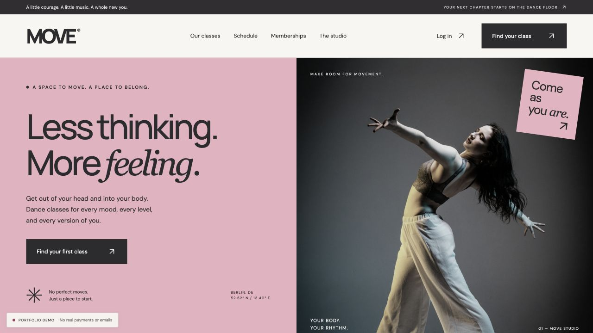
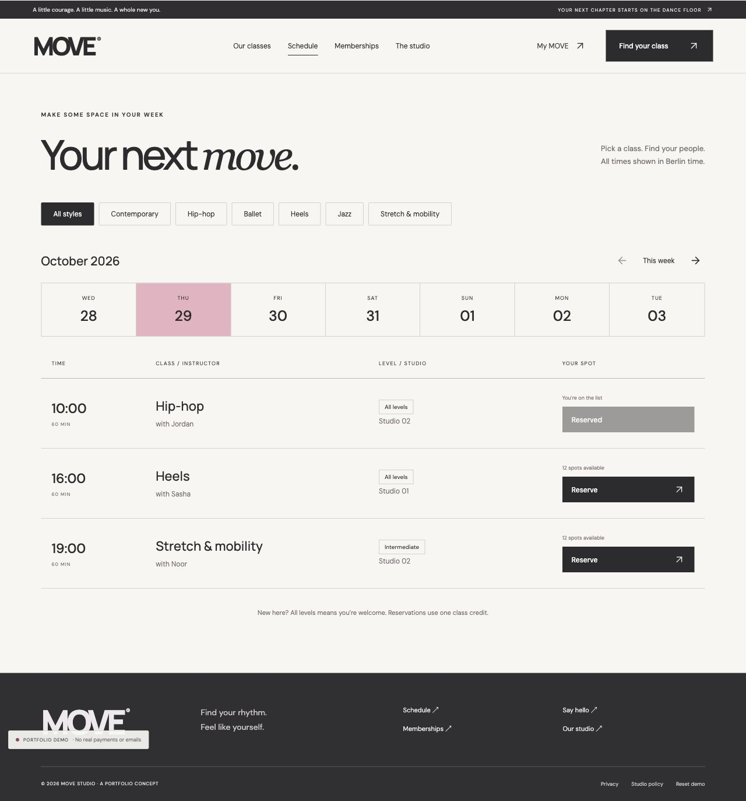
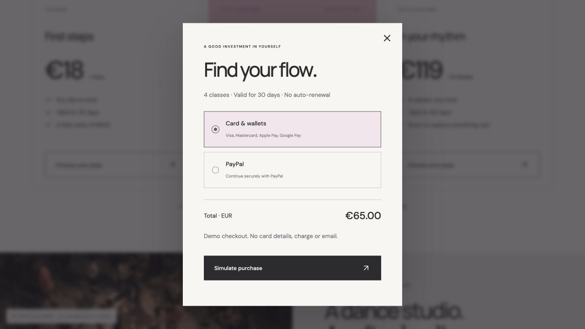
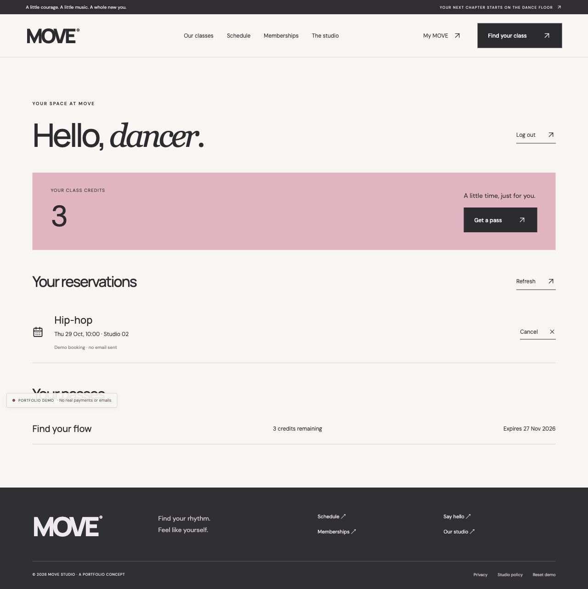
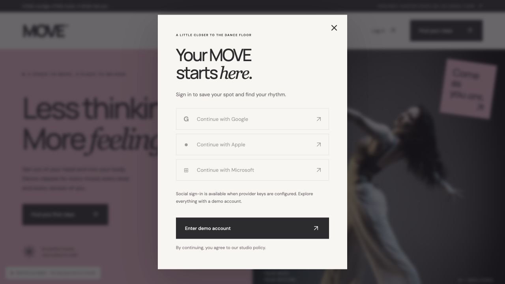
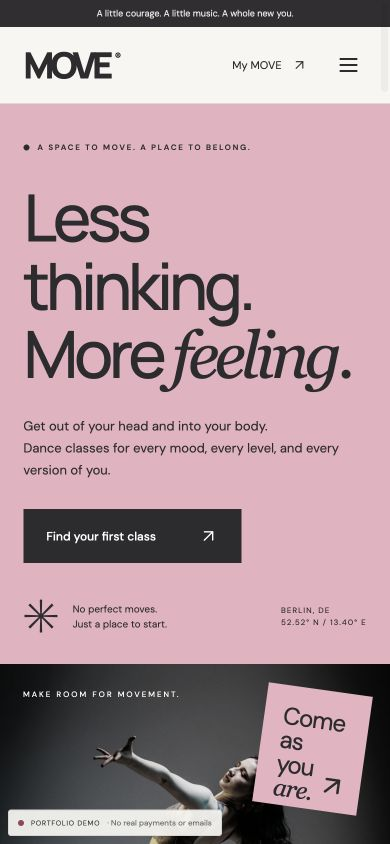

# MOVE — Dance Studio

**Less thinking. More feeling.**

A responsive React application for a fictional dance school: explore dance styles, find a class, buy a class pass and reserve a place. An editorial visual direction pairs dusty pink, graphite, oversized typography and dance photography.

> Portfolio project. Demo mode is enabled by default: no real authentication, payments or emails. Connected integrations are implemented but require your provider accounts and sandbox verification before real use.



## Try it in two minutes

Requires **Node.js 24+** and npm. SQLite is bundled with Node; no separate database installation is needed. Node 24 may display an experimental SQLite warning.

```bash
npm ci
cp .env.example .env
npm run dev
```

On Windows PowerShell, replace `cp .env.example .env` with `Copy-Item .env.example .env`.

Open **http://127.0.0.1:5173**. Click **Log in → Enter demo account**, choose a membership, click **Simulate purchase**, then reserve a future class. **My MOVE** shows your credits and reservations. Cancel at least 12 hours before a class to restore its credit.

Demo data persists in this browser. Use **Reset demo** in the footer to clear it. Sign-out ends the demo session but preserves its demo data.

## What it does

- Six dance styles with class descriptions and photography.
- A rolling two-week schedule, style filters, dates, levels, teachers and available spaces.
- Three one-time class passes; no recurring billing.
- Reservation confirmation, personal dashboard and cancellation with credit return.
- Responsive desktop/mobile layouts, keyboard focus indicators, modal focus management, Escape-to-close and reduced-motion support.
- Google, Apple and Microsoft OAuth through Supabase in connected mode.
- Stripe hosted Checkout for cards and eligible wallets; PayPal Orders API for PayPal checkout.
- Durable SQLite bookings, server-controlled prices and credits, transactional capacity checks and idempotent payment fulfillment.
- Resend confirmation/cancellation emails through a durable retry outbox.

| Capability         | Demo mode                        | Connected mode                                     |
| ------------------ | -------------------------------- | -------------------------------------------------- |
| Identity           | Clearly labelled demo account    | Supabase-verified OAuth user                       |
| Storage            | Browser localStorage             | SQLite on the Node server                          |
| Payments           | Simulated pass purchase          | Stripe Checkout / PayPal approval + server capture |
| Confirmation email | Explicitly not sent              | Resend outbox, subject to configuration/delivery   |
| Availability       | This browser's demo reservations | Shared server-side capacity                        |

## Screenshots

### Schedule



### Membership checkout



### My MOVE



<details>
<summary>Sign-in and mobile layout</summary>





</details>

Screenshots show the running application with sample data, rather than design mockups. Schedule dates are generated at runtime.

## Technology & structure

**React 19 · Vite · JavaScript · CSS · Lucide · Express 5 · SQLite · Supabase Auth · Stripe · PayPal · Resend**

```text
src/
  App.jsx                 App state, authentication, dialogs and checkout
  components/
    Home.jsx              Editorial homepage, styles, passes and FAQ
    Schedule.jsx          Date and style filters, class availability
    Account.jsx           Reservations, passes and cancellation
    Arrow.jsx             Shared visual component
  api.js                  Demo adapter and authenticated HTTP client
  data.js                 Shared pass catalog and sample class generator
  styles.css              Design system and responsive layouts
server/
  index.js                API, authentication, payment adapters and email worker
  store.js                SQLite schema, transactions and booking rules
tests/                    Node test runner: booking and schedule invariants
public/images/            Local photographic assets
docs/                     Integration guide, verification notes and screenshots
.github/workflows/ci.yml  Tests and production build on pushes/PRs
.env.example              Public configuration template; no real secrets
```

The same frontend API contract supports a local demonstration and a server-backed mode. Prices are defined on the server from the shared catalog; the client submits only a plan ID. A successful return URL never grants Stripe credits: only a verified payment webhook does. PayPal credits are granted only after a server-verified completed capture. Database uniqueness prevents repeated provider events from granting duplicate passes.

## Commands

| Command          | Purpose                                                         |
| ---------------- | --------------------------------------------------------------- |
| `npm run dev`    | Vite on 5173 and API on 3001                                    |
| `npm test`       | Booking, credit, capacity, expiry, ownership and schedule tests |
| `npm run build`  | Build the React app to `dist/`                                  |
| `npm start`      | Serve built frontend and API at http://127.0.0.1:3001           |
| `npm run format` | Format source and documentation with Prettier                   |

The frontend updates automatically in development. Restart `npm run dev` after backend or environment changes. To preview the production build, stop development, run `npm run build`, then `npm start`.