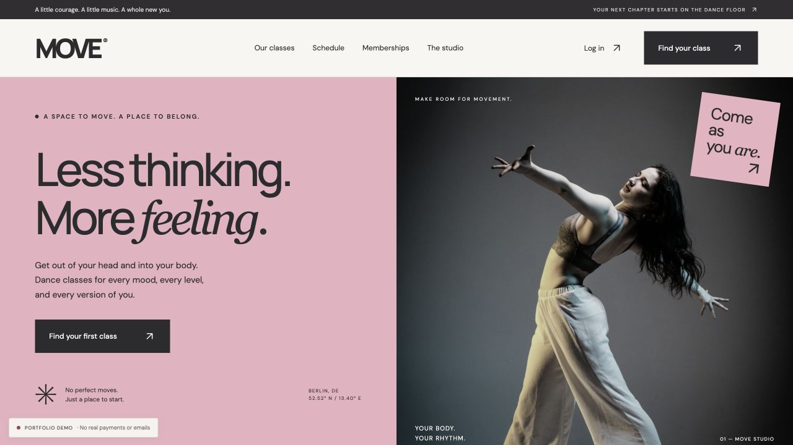
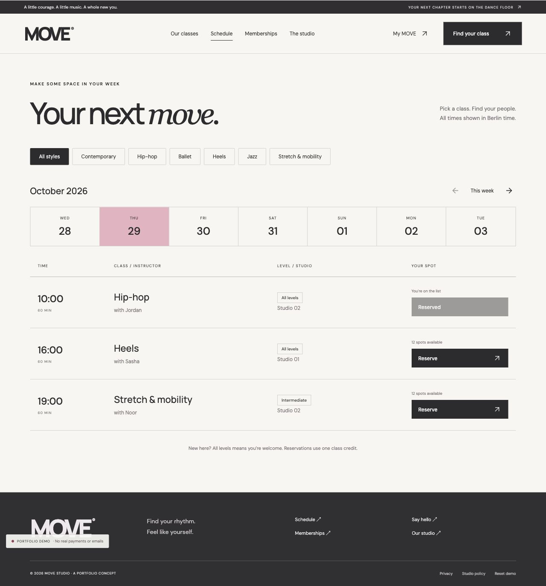
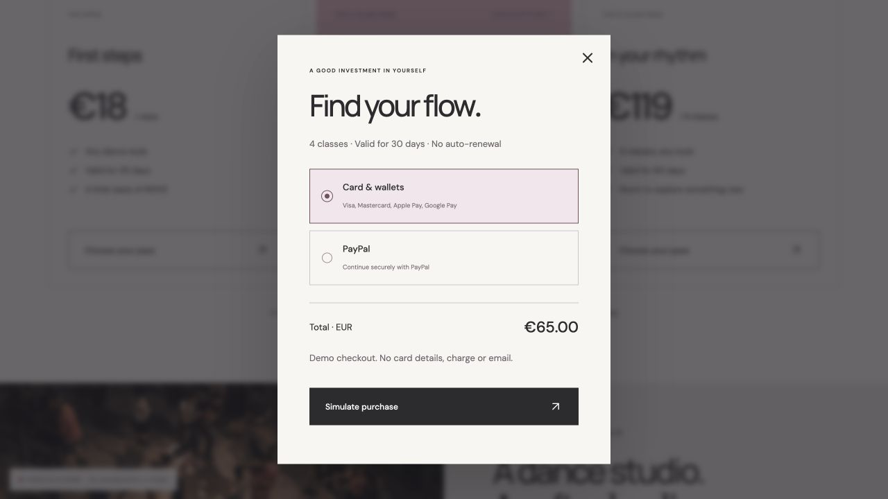
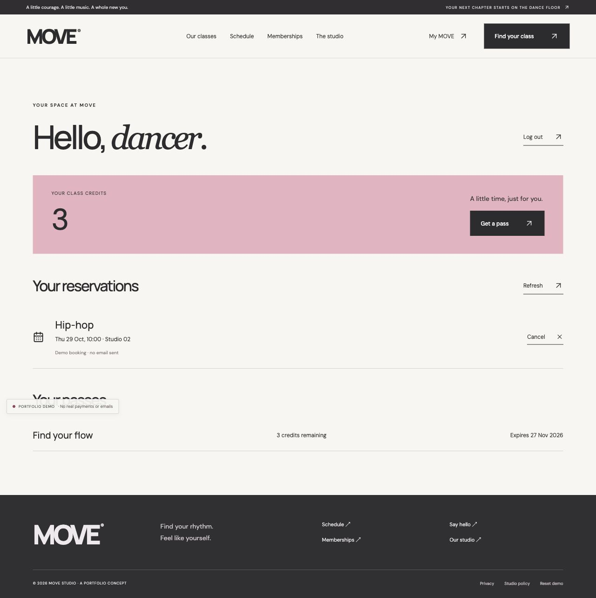
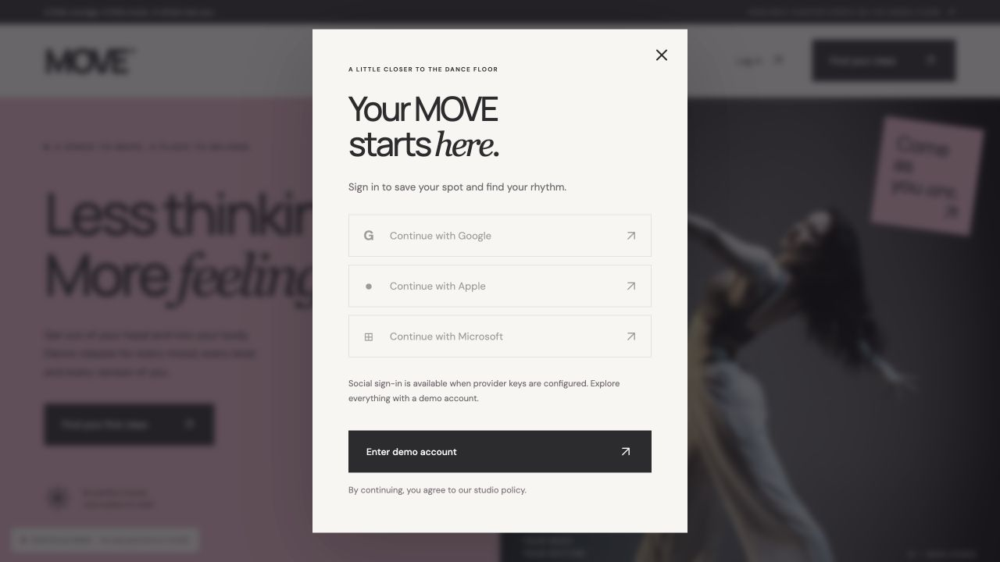
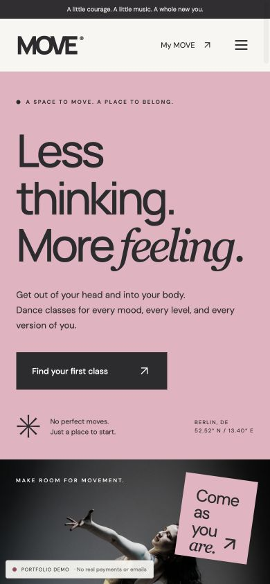

# MOVE — Dance Studio

**Less thinking. More feeling.**

A responsive React application for a fictional dance school: explore dance styles, find a class, buy a class pass and reserve a place. An editorial visual direction pairs dusty pink, graphite, oversized typography and dance photography.

> Portfolio project. Demo mode is enabled by default: no real authentication, payments or emails. Connected integrations are implemented but require your provider accounts and sandbox verification before real use.



## Try it in two minutes

Requires **Node.js 24+** and npm. SQLite is bundled with Node; no separate database installation is needed. Node 24 may display an experimental SQLite warning.

```bash
npm ci
cp .env.example .env
npm run dev
```

On Windows PowerShell, replace `cp .env.example .env` with `Copy-Item .env.example .env`.

Open **http://127.0.0.1:5173**. Click **Log in → Enter demo account**, choose a membership, click **Simulate purchase**, then reserve a future class. **My MOVE** shows your credits and reservations. Cancel at least 12 hours before a class to restore its credit.

Demo data persists in this browser. Use **Reset demo** in the footer to clear it. Sign-out ends the demo session but preserves its demo data.

## What it does

- Six dance styles with class descriptions and photography.
- A rolling two-week schedule, style filters, dates, levels, teachers and available spaces.
- Three one-time class passes; no recurring billing.
- Reservation confirmation, personal dashboard and cancellation with credit return.
- Responsive desktop/mobile layouts, keyboard focus indicators, modal focus management, Escape-to-close and reduced-motion support.
- Google, Apple and Microsoft OAuth through Supabase in connected mode.
- Stripe hosted Checkout for cards and eligible wallets; PayPal Orders API for PayPal checkout.
- Durable SQLite bookings, server-controlled prices and credits, transactional capacity checks and idempotent payment fulfillment.
- Resend confirmation/cancellation emails through a durable retry outbox.

| Capability         | Demo mode                        | Connected mode                                     |
| ------------------ | -------------------------------- | -------------------------------------------------- |
| Identity           | Clearly labelled demo account    | Supabase-verified OAuth user                       |
| Storage            | Browser localStorage             | SQLite on the Node server                          |
| Payments           | Simulated pass purchase          | Stripe Checkout / PayPal approval + server capture |
| Confirmation email | Explicitly not sent              | Resend outbox, subject to configuration/delivery   |
| Availability       | This browser's demo reservations | Shared server-side capacity                        |

## Screenshots

### Schedule



### Membership checkout



### My MOVE



<details>
<summary>Sign-in and mobile layout</summary>





</details>

Screenshots show the running application with sample data, rather than design mockups. Schedule dates are generated at runtime.

## Technology & structure

**React 19 · Vite · JavaScript · CSS · Lucide · Express 5 · SQLite · Supabase Auth · Stripe · PayPal · Resend**

```text
src/
  App.jsx                 App state, authentication, dialogs and checkout
  components/
    Home.jsx              Editorial homepage, styles, passes and FAQ
    Schedule.jsx          Date and style filters, class availability
    Account.jsx           Reservations, passes and cancellation
    Arrow.jsx             Shared visual component
  api.js                  Demo adapter and authenticated HTTP client
  data.js                 Shared pass catalog and sample class generator
  styles.css              Design system and responsive layouts
server/
  index.js                API, authentication, payment adapters and email worker
  store.js                SQLite schema, transactions and booking rules
tests/                    Node test runner: booking and schedule invariants
public/images/            Local photographic assets
docs/                     Integration guide, verification notes and screenshots
.github/workflows/ci.yml  Tests and production build on pushes/PRs
.env.example              Public configuration template; no real secrets
```

The same frontend API contract supports a local demonstration and a server-backed mode. Prices are defined on the server from the shared catalog; the client submits only a plan ID. A successful return URL never grants Stripe credits: only a verified payment webhook does. PayPal credits are granted only after a server-verified completed capture. Database uniqueness prevents repeated provider events from granting duplicate passes.

## Commands

| Command          | Purpose                                                         |
| ---------------- | --------------------------------------------------------------- |
| `npm run dev`    | Vite on 5173 and API on 3001                                    |
| `npm test`       | Booking, credit, capacity, expiry, ownership and schedule tests |
| `npm run build`  | Build the React app to `dist/`                                  |
| `npm start`      | Serve built frontend and API at http://127.0.0.1:3001           |
| `npm run format` | Format source and documentation with Prettier                   |

The frontend updates automatically in development. Restart `npm run dev` after backend or environment changes. To preview the production build, stop development, run `npm run build`, then `npm start`.

## Enable real integrations

See **[docs/INTEGRATIONS.md](docs/INTEGRATIONS.md)** for Google/Apple/Microsoft setup, Stripe webhooks, PayPal sandbox and Resend configuration. Set `VITE_DEMO_MODE=false` only after configuring the required identity service. Rebuild after changing any `VITE_` variable.

Wallet availability is controlled by the payment provider, merchant account, device, browser and region. Apple Pay and Google Pay are not guaranteed to appear on every checkout.

## Deployment

**Portfolio demo:** deploy the output of `npm run build` to any static host, at the domain root, with `VITE_DEMO_MODE=true`. No backend is required. Sites can host the static demo only; the Express server is included in the source and needs a separate Node host. The attempted private preview publication was blocked by the local permission policy; no live URL is included.

**Connected application:** deploy Node 24 behind an HTTPS reverse proxy, serve `dist/` with `npm start`, persist `.data/` on disk and configure the production `APP_URL`, OAuth redirects and Stripe webhook endpoint. This implementation binds to loopback for a same-machine reverse proxy. Do not use an ephemeral filesystem or run multiple app instances against separate SQLite databases.

This is a portfolio foundation, not an operational studio platform. Sample schedules/instructors are fictional. Admin scheduling, attendance, refunds/disputes, chargeback credit reconciliation, account deletion, billing/tax rules and monitoring are not implemented. PayPal capture relies on the customer returning to the application; interrupted returns need recovery/reconciliation before commercial launch. See the integration guide for these limits.

## Publish the source on GitHub

Create an **empty** GitHub repository named `move-dance-studio` (do not initialize it with a README), then run these commands inside this project folder:

```bash
git init
git add src server public docs tests .github .gitignore .env.example .prettierignore .nvmrc package.json package-lock.json index.html vite.config.js README.md
git commit -m "Build MOVE dance studio portfolio"
git branch -M main
git remote add origin https://github.com/YOUR_USERNAME/move-dance-studio.git
git push -u origin main
```

Replace `YOUR_USERNAME`. Authenticate using GitHub's browser flow, SSH or a personal access token; do not put tokens in source files. These instructions assume a fresh folder with no Git remote. If reusing a checkout, run `git remote -v` first and use `git remote set-url origin ...` when needed.

**Commit:** application/server source, local images, docs/screenshots, tests, CI workflow, `.env.example`, configuration and lockfile.

**Do not commit:** `.env`, `.data/`, `node_modules/`, `dist/`, logs or `.openai/` hosting metadata. `.gitignore` already excludes these. Use `git status` before committing to verify the file list.

## Portfolio talking points

- Building a responsive booking flow with React state and accessible modal interactions.
- Separating a browser-only demo adapter from an authenticated API.
- Using database transactions and uniqueness constraints to protect inventory and credits.
- Integrating asynchronous payment confirmation and idempotent fulfillment.
- Keeping email delivery outside the booking transaction through an outbox.
- Testing business rules and documenting the limits of unverified external integrations.

Use only claims you can explain and demonstrate in an interview. Provider integrations have not been exercised with real account credentials in this delivery.

## Assets & references

Photos are illustrative assets from [Unsplash](https://unsplash.com/license), not the MOVE team or premises. Direct image sources are recorded in [docs/ASSETS.md](docs/ASSETS.md). Fonts: DM Sans and Manrope via Google Fonts, with system fallbacks. Icons: Lucide.

Provider documentation: [Supabase OAuth](https://supabase.com/docs/reference/javascript/auth-signinwithoauth), [Stripe fulfillment](https://docs.stripe.com/checkout/fulfillment), [PayPal Orders API](https://developer.paypal.com/docs/api/orders/v2/), [Resend send email](https://resend.com/docs/api-reference/emails/send-email).
